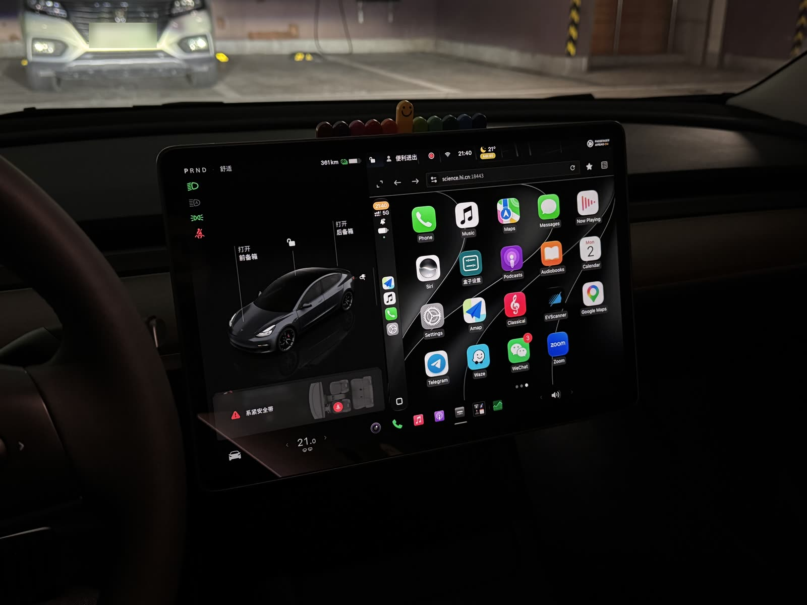
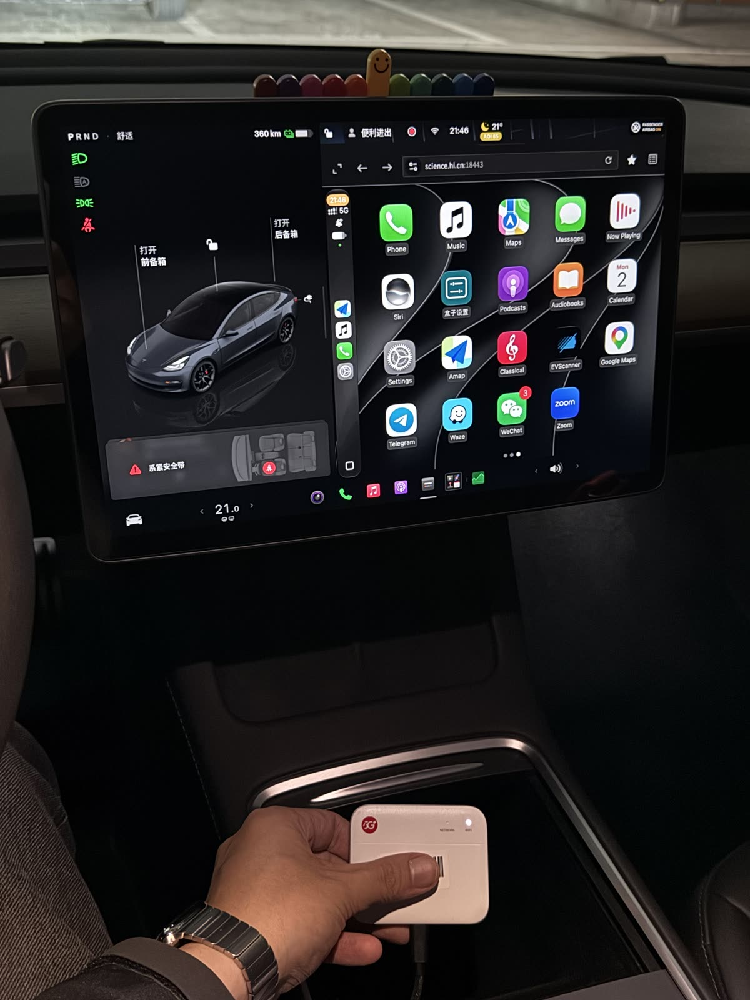

# AutoPlay

**Wireless CarPlay in a Tesla, with nothing in the car but a ¥400 (about $55) ZTE F50 pocket router.** Flashed to OpenWrt and running this project, the F50 is what the iPhone connects to, exactly as it would connect to a CarPlay head unit; the CarPlay picture appears in the Tesla's own browser, a finger on the screen goes straight back to the iPhone, and music, navigation prompts, calls and Siri all play through the Tesla's own Bluetooth. No modification to the car, no app, no Android box in the cup holder.

 

[中文](README.md) · current release **1.5.1** (2026-11-11) · [changelog](CHANGELOG.md) · [install and usage guide (Chinese)](交付资料/AutoPlay-1.5.1-安装使用说明.md)

## Why this route

A Tesla has no CarPlay and takes no third-party apps, but it does have a usable browser. So every existing approach is "show, in the browser, a CarPlay rendered somewhere else": a Raspberry Pi or an Android box in the car, or an old phone as a relay. Each needs a device of some size, a cable of some length, and an answer to heat and power.

AutoPlay shrinks the "somewhere else" as far as it goes. CarPlay is, at bottom, the iPhone sending an H.264 / H.265 video stream over AirPlay to a head unit that only decodes and displays it. If the receiver neither decodes nor transcodes but forwards the iPhone's stream untouched to the Tesla's browser, which decodes it with WebCodecs, the receiver has three jobs left: speak Bluetooth iAP2 and AirPlay to the iPhone, run a Wi-Fi hotspot, and move bytes. A pocket router's SoC does that comfortably; the Unisoc T760 in the ZTE F50 was designed for phones, has 5 GHz Wi-Fi and Bluetooth, gets online with a SIM, and is powered by the car's USB port.

So the project has exactly one target: one F50, one Tesla, one iPhone. Other cars, other boxes, wired CarPlay and a macOS receiver exist upstream and were removed here.

## How a frame reaches the screen

In the car the F50 runs a 5 GHz hotspot with its LAN fixed at 100.96.0.1/24 (a Tesla's browser refuses private addresses such as 192.168.x.x but accepts the 100.64/10 range). When the iPhone comes near, the box hands it the hotspot's name and password over Bluetooth iAP2; the iPhone joins and then does what it does with any CarPlay head unit: accessory authentication, resolution negotiation, video.

Every H.264 or H.265 frame the JVM receiver gets is pushed, unchanged, over one WSS connection to the page open in the car's browser. The page decodes it with WebCodecs onto a canvas; every touch on that canvas travels back to the iPhone. When the browser window changes shape (borderless mode, say) the page has the iPhone draw at the new size instead of stretching the old picture.

Sound does not take this path. The receiver offers the iPhone no audio formats at all, so the iPhone falls back to its non-CarPlay rule and sends music, navigation prompts, calls and Siri to the Bluetooth device it is connected to, which is the Tesla. The car's native media card and wheel controls keep working, the page is silent, and there is no "tap to enable sound" step. 1.1.0 made this the default and kept an alternative in which the page played the prompts; once the owner had confirmed in the car that Bluetooth works, 1.3.0 removed the alternative together with every line of audio code in the page, which no longer needs Web Audio at all (`docs/AUDIO.md`). Nor can the page play music: a moving Tesla answers a music-playing page with a "video is audio-only" banner that resizes the page, and CarPlay renegotiates every few seconds.

The car opens `https://<your domain>:18443/`. The domain is your own (DuckDNS or Tencent DNSPod); the certificate comes from Let's Encrypt via acme.sh on the box, DNS-01, no open ports; the box's dnsmasq resolves the name to 100.96.0.1. That is why a SIM is not optional: issuing and renewing need the internet, and a Tesla will not stay on a Wi-Fi network that has none.

The fuller architecture is in `docs/ARCHITECTURE.md`, every "why" in `docs/DECISIONS.md`, and the Tesla browser's constraints together with what we confirmed in the car in `docs/TESLA.md` (all in Chinese).

## Where things stand

**1.0.0 (2026-11-02) ran in a 2022 Model 3 (AMD MCU):** wireless CarPlay from an iPhone 15 Pro on iOS 27.2, picture, touch and navigation prompts, shown in the car's browser through the F50, with an HTTPS certificate from Let's Encrypt issued over a Chinese SIM via the DNSPod route. The same day settled two facts: this car finds the hotspot only on 5 GHz channels 149–165, which the mu300-linux image's country code (TR) does not have, so the package sets the radio to CN / 149; and the car's browser opened the own-domain page without a certificate warning.

**1.1.0** moved all sound to the Tesla's Bluetooth by default and brought in the reliability fixes upstream DashPlay made in the car in late October and early November: unblocking rfkill when the F50's Bluetooth controller comes up, a generation guard in the pairing agent, a full idle grace for every new connection, automatic removal of a corrupt AppCDS archive, and waiting for the network before asking for a certificate. **1.2.0** changed no behaviour, only the interface: both pages were checked screen by screen at the car browser's real window shapes (773×601 windowed, 1256×706 borderless, in CSS pixels), the viewer's five dropdowns became a large in-page option sheet, the box's settings page moved to the same type and touch scale, the pairing code and its buttons sit above the fold, and removing a phone or installing an update no longer depends on the browser's `confirm()` box (`docs/UI-1.2.0.md`). **1.3.0** works through the owner's list after a week in the car: the settings panel is brought in line with iOS Settings (a coloured icon, a label and the current value on every row, no small print), the page's sound and the fallback controls are gone, the box page no longer announces "upstream online", and the on-screen keyboard that sometimes appeared when the browser was brought back is addressed by never letting the canvas hold focus (`docs/UI-1.3.0.md`).

Since **1.3.1** every release is compiled and tested by GitHub Actions, signed and published, and the box updates itself from its settings page (`docs/RELEASE.md`). **1.4.0** can hand the Tesla's position to the iPhone for CarPlay navigation (off by default); the design comes from research rather than trial in the car: the iPhone uses bad car positions as readily as good ones, so only fresh, continuous fixes are sent and otherwise nothing (`docs/LOCATION.md`). **1.4.1** borrows from DashPlay 11.04: after an unexpected wireless drop the box invites that iPhone back once, and a picture stream stuck mid-frame reconnects within 10 s; the box settings page is laid out again for each window shape and keeps its top bar for things that need action. **1.4.2** fetches online updates through the GitHub API first (github.com's download links answered 502 on the owner's network). **1.4.3** makes the drive log more complete (each temperature zone, throttling, the page's whole report). **1.5.0**: the datum defaults to "automatic" (GCJ-02 in mainland China, as an owner measured on a China-market Model 3); the box page was rebuilt to look like the CarPlay page's settings panel, and the waiting screen, the settings panel and the box page now have day and night colours that follow the night-mode setting (`docs/UI-1.5.0.md`); the box page shows its temperature and warns while it is throttled for heat; and AutoPlay comes back by itself after a mu300-linux system update. **1.5.1** puts the settings panel's title and "Done" where the box page has its title and back button (with the content on a wide screen, the same sizes on a phone).

Still to confirm in the car: the keyboard fix (its trigger could not be reproduced on a bench); for car location, how often the browser reports a new position while driving (the datum was checked by an owner against the iPhone's Compass on one China-market Model 3 and defaults to "automatic" since 1.5.0; pick it by hand if another model or firmware differs); how 1.5.0's day and night colours and the box page's back button behave in the car's browser (checked only in a desktop browser at the car's window sizes); and the reinstall of AutoPlay after a mu300-linux system update (not yet run on a real device). Other known, untouched items are listed at the end of each release in `CHANGELOG.md`. There is no long-term soak data yet.

## What you need

**A ZTE F50**, model MU300. Ours shipped with stock firmware **B13** and runs [mu300-linux](https://github.com/dikeckaan/mu300-linux)'s OpenWrt 25.12 image (vendor 5.4 kernel). For flashing, rooting and going back to Android, use mu300-linux's own documentation only; this repository gives no such steps and makes no claim about which firmware versions can be flashed; upstream DashPlay's flashing scripts for stock B16 were never used here and have been removed. In the car, give it 5 V at 3 A or more from a port that stays powered through ignition, a short thick cable, a heatsink, and a spot out of the sun: heat and power are the two biggest risks of an F50 in a car.

**A SIM with data**, for the reasons above. **A domain of your own**: a DuckDNS subdomain, or a domain hosted at Tencent DNSPod (whether DuckDNS's update API is reachable over a Chinese SIM is unverified, which is why the DNSPod route exists).

**A CarPlay accessory identity** (`identity.pk8` and `certificate.p7b`). CarPlay requires accessories to pass Apple's MFi authentication; AutoPlay is not an Apple-certified product, and nothing in this repository, its packages, docs or tests contains identity material, nor does the software download any. It only reads the files you place in `/opt/autoplay/identity/offline-mfi/`. Shared identities circulating publicly may be revoked at any time; how to obtain a legitimate one is outside this project's scope (`docs/SECURITY.md`, `NOTICE.md`).

**In the car** there are three settings: join the box's Wi-Fi and turn on "Remain connected in Drive" (otherwise Wi-Fi drops as soon as you leave Park); pair the iPhone over Bluetooth and make it the media source; bookmark `https://<your domain>:18443/`.

## Installing and using it

The full procedure is in the [install guide](交付资料/AutoPlay-1.5.1-安装使用说明.md) (Chinese); here is the outline. On a computer, build the receiver (JDK 21 + Gradle) and the viewer page (Node), then use the OpenWrt Docker SDK to produce four apk packages: `autoplay` (the program, installed under `/opt/autoplay`), `autoplay-jre` (a jlink-trimmed Temurin 21), `luci-app-autoplay` and its Chinese translation. Copy them to the box, `apk add` them, run `board_zte_f50.py --setup` once so the F50's Bluetooth uses the private BlueZ (do not `apk add bluez-daemon`; it pulls in mismatched kernel modules), place the identity files, restart the service. The install script moves the LAN to 100.96.0.1, sets the 5 GHz radio to CN / 149, and keeps any channel in 149–165 you chose in LuCI.

After that there are three places to look and change things:

- `https://<your domain>:18443/` is the **viewer**, the page the car opens. Waiting, connecting and reconnecting states are written on the page; the waiting screen has a "Settings" row, and once the picture is up the "Box settings" icon on the CarPlay home screen opens the same panel: night mode, language, CarPlay content size, frame rate, codec, and a few compatibility switches.
- `http://100.96.0.1:18080/` is the **box settings page** (titled "AutoPlay 盒子"; the CarPlay page links to it as "Open box page"), for the owner. Since 1.5.0 it looks like the CarPlay page's settings panel, with four categories on the left: *iPhone* (the hotspot–box–iPhone chain at a glance, adding and removing iPhones; the pairing code is confirmed here), *网络* (the Wi-Fi handed to the iPhone, the addresses the car opens, certificate expiry), *更新* (checking for and installing a new version) and *高级* (the box's temperature, a diagnostics download, a factory reset). Like the CarPlay page's waiting screen and settings panel, its colours follow CarPlay's day or night; opened from the panel, its "返回" (back) button returns there. It works without JavaScript.
- `http://100.96.0.1/` is **LuCI**; under Services → AutoPlay there are four tabs: Network, iPhone, Own address (DuckDNS / DNSPod credentials), Program update.

Since 1.3.1 every version is a signed GitHub Release (`docs/RELEASE.md`): the box checks once a day, announces a new version on its settings page and in LuCI, and on "upgrade now" backs up pairings, certificate and settings, downloads the way back first, installs, and rolls back by itself if the new version does not come up. A box still on an earlier version is updated by hand once, to 1.3.1 or later (which carry the project's own public key); after that no computer is needed. Pairings, certificates and identity stay under `/opt/autoplay/`.

## What is in the repository

`receiver/` is the Kotlin/JVM receiver: Bluetooth iAP2, AirPlay/CarPlay, the MFi signer interface, the WSS server, and the TypeScript viewer in `receiver/web/`. It is a hard fork of PlayPort with DashPlay's 63 patches replayed as git history, then trimmed to "Tesla only": wired mode, macOS, microphone uplink, now-playing and artwork, and the XPeng fullscreen family are gone (`receiver/docs/TRIM-LOG.md`).

`box/` is the Python that runs on the box: the procd supervisor with per-component restarts, F50 Bluetooth bring-up, the status model in `/var/run/autoplay/status.json` (nine domains: bluetooth, wifi, uplink, identity, phone, certificate, update, system, tesla, each `{state, reason, since}`), the settings page, certificate maintenance, the update journal with rollback, factory reset. It comes from DashPlay with Debian, N1, Onecloud, STA mode, external routers, IPv6, the local CA and wired CarPlay removed, renamed autoplay (`box/docs/TRIM-LOG.md`, `box/docs/STATUS-MODEL.md`).

`openwrt/` holds the package definitions for the apks above and the LuCI app, from openwrt-dashplay. `tools/` is new here: `probe/`, a single HTML file that measures the car browser's capabilities when opened in it; `f50/`, hardening and measurement scripts; `car/`, a method for measuring touch latency. `docs/` covers architecture, decisions, build, test, the Tesla specifics, audio, security and the two interface iterations.

`docs/BUILD.md` says how to build and `docs/TEST.md` how to test (238 box-side unit tests, four viewer check scripts, the install script's and tools' own tests, all runnable on a desktop).

## Origins and license

AutoPlay is a GPL-3.0 hard fork of [PlayPort](https://github.com/youcci/playport), [DashPlay](https://github.com/yizhixiaoheigou/DashPlay) and [openwrt-dashplay](https://github.com/yizhixiaoheigou/openwrt-dashplay), which in turn build on [DiPlay](https://github.com/shihabal3amri/DiPlay), [xcertplay](https://github.com/shilapi/xcertplay) and WheelPlay; the F50 Bluetooth bring-up, the Tesla mode, the browser compatibility fixes and much hard-won reliability experience come from the DashPlay author's work in a real car. The full attribution chain is in `NOTICE.md`.

License: GPL-3.0 (`LICENSE`). CarPlay, iPhone, AirPlay and MFi are trademarks of Apple Inc.; Tesla is a trademark of Tesla, Inc. This project is not affiliated with or endorsed by Apple, Tesla, or the authors of the upstream projects.
