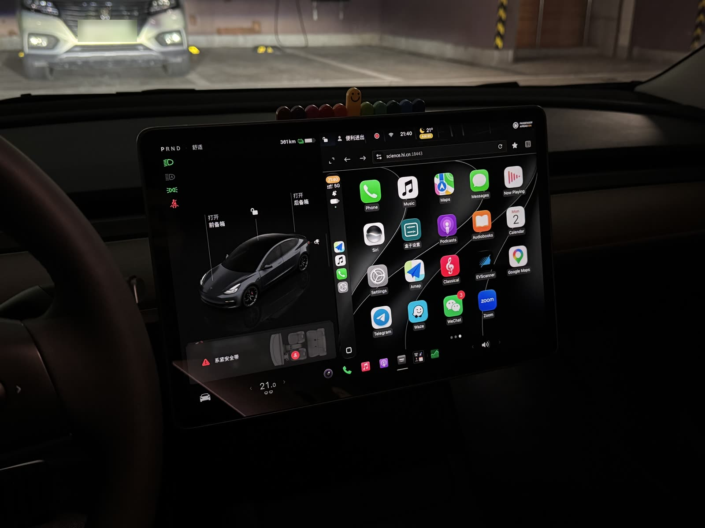
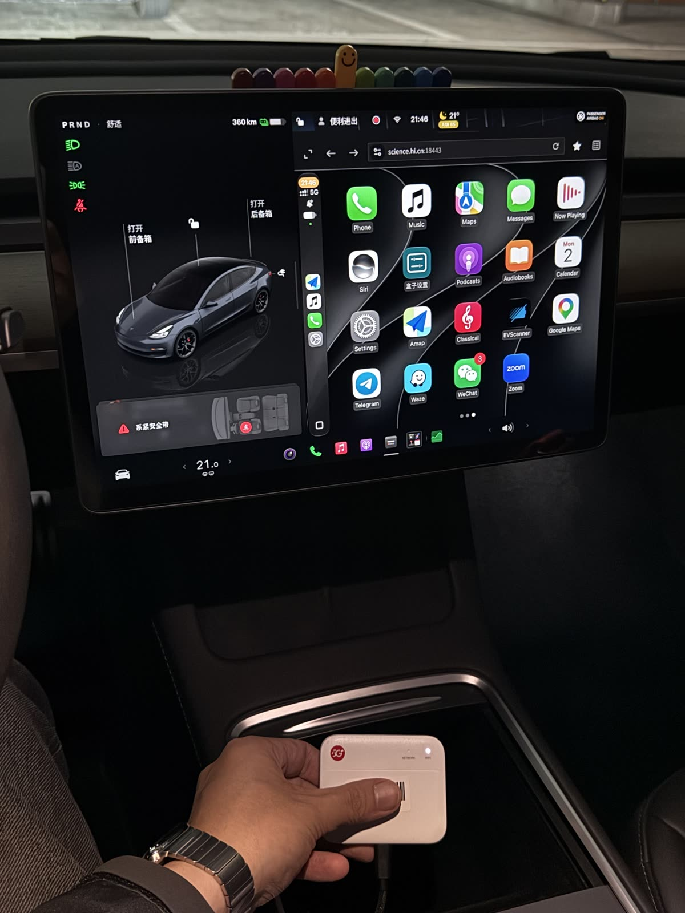

# AutoPlay

**让特斯拉用上无线 CarPlay，整套硬件只是一台四百块的中兴 F50 随身 WiFi。** 它刷成 OpenWrt 后装上本项目，iPhone 像连普通 CarPlay 车机一样连上它；CarPlay 的画面出现在特斯拉车机自带的浏览器里，手指点在屏幕上直接传回 iPhone；音乐、导航播报、通话和 Siri 都走特斯拉自己的蓝牙。不改车，不装 App，不需要在车里再塞一台安卓盒子。

 

[English](README.en.md) · 当前版本 **1.2.0**（2026-11-02）· [变更记录](CHANGELOG.md) · [安装使用说明](交付资料/AutoPlay-1.2.0-安装使用说明.md)

## 为什么是这条路

特斯拉的车机不支持 CarPlay，也不允许装第三方应用，但它有一个能用的浏览器。于是现有的办法都是"在浏览器里显示一个别处渲染的 CarPlay"：有人在车里放树莓派或安卓盒子，有人用一台旧手机做中转。它们都要一台不小的设备、一根不短的线，还得处理发热和供电。

AutoPlay 想做的是把这台"别处"缩到最小。CarPlay 的本质是 iPhone 通过 AirPlay 协议把 H.264 / H.265 视频流发给车机，车机只负责解码和显示。如果接收端不解码、不转码，只是把 iPhone 发来的视频原样转给特斯拉的浏览器，让浏览器用 WebCodecs 解码，那么接收端的工作就只剩下三件事：和 iPhone 讲蓝牙 iAP2 与 AirPlay、开一个 Wi-Fi 热点、转发字节。这三件事一颗随身 WiFi 的 SoC 完全够用——中兴 F50 用的紫光展锐 T760 本来就是给手机设计的，带 5 GHz Wi-Fi 和蓝牙，插 SIM 能上网，插车上的 USB 口就有电。

所以项目只做这一个目标：一台 F50，一辆特斯拉，一部 iPhone。其他车、其他盒子、有线 CarPlay、macOS 接收端，上游有，这里都删掉了。

## 一帧画面是怎么到屏幕上的

上车后，F50 开着一个 5 GHz 热点（局域网固定在 100.96.0.1/24——特斯拉的浏览器拒绝打开 192.168 这类私网地址，但 100.64/10 这段可以）。iPhone 靠近时，盒子通过蓝牙 iAP2 告诉它热点的名字和密码，iPhone 自己连上来，然后按 CarPlay 的规矩和盒子上的 JVM 接收端握手：配件认证、协商分辨率、开始发视频。

接收端收到的每一帧 H.264 或 H.265，不拆不改，经一条 WSS 连接推给车机浏览器里打开的页面。页面用 WebCodecs 解码，画到一块 canvas 上；手指在 canvas 上的每一次按下、移动、抬起，原路送回 iPhone。车机浏览器的窗口形状变了（比如开了无边框模式），页面会让 iPhone 按新尺寸重新出图，而不是把旧画面拉伸。

声音不走这条路。从 1.1.0 起，接收端默认不向 iPhone 提供任何音频格式，iPhone 就按它不在 CarPlay 时的规则，把音乐、导航播报、通话和 Siri 全部交给已连接的蓝牙设备——也就是特斯拉本身。车机原生的媒体卡片和方向盘切歌照常可用，页面不出声，上车不需要"轻点一下开启声音"。如果经蓝牙听不到导航播报，有一个备选模式让页面来播导航（`docs/AUDIO.md`）。无论哪种模式页面都不播音乐：行驶中的特斯拉会对播音乐的网页弹出"视频只有声音"的横幅，横幅改变页面尺寸，CarPlay 就会每隔几秒重新协商一次。

车机打开的是 `https://<你的域名>:18443/`。域名是你自己的（DuckDNS 或腾讯云 DNSPod），证书由盒子上的 acme.sh 向 Let's Encrypt 申请，走 DNS-01，不开任何端口；盒子自己的 dnsmasq 把这个名字解析到 100.96.0.1。这就是为什么 SIM 卡不是可选项：签发和续期都要上网，而且特斯拉不会停留在一个没有互联网的 Wi-Fi 上。

更完整的架构在 `docs/ARCHITECTURE.md`，每一个"为什么这样做"在 `docs/DECISIONS.md`，特斯拉浏览器的各种硬约束和我们在实车上确认的事实在 `docs/TESLA.md`。

## 现在到了哪一步

**1.0.0（2026-11-02）在一辆 2022 款 Model 3（AMD 车机）上跑通了**：iPhone 15 Pro（iOS 27.2）的无线 CarPlay 画面、触摸、导航播报经 F50 显示在车机浏览器里，HTTPS 证书来自 Let's Encrypt（DNSPod 路线，国内 SIM 签发成功）。这一天也确认了两件事：这辆车只在 5 GHz 的 149–165 信道上搜得到热点，而 mu300-linux 镜像自带的国家码 TR 没有这些信道，所以安装包会把无线设为 CN / 149；车机浏览器打开自有域名的页面没有证书警告。

**1.1.0** 把声音默认交给了特斯拉蓝牙，并引入了上游 DashPlay 十月下旬到十一月初在实车上做的一批可靠性修复：F50 蓝牙控制器上电时解除 rfkill 软阻塞、配对代理的"代际"保护、每个新连接完整的空闲宽限、损坏的 AppCDS 归档自动删除、证书申请前先确认网络通了再出手。**1.2.0** 没有改功能，只改界面：两张页面按车机浏览器真实的窗口形状（带边框 773×601、无边框 1256×706 CSS 像素）逐屏核对，投屏页的五个下拉改成页内的大号选项表，盒子设置页换到同一套字号和触控尺度，配对码和按钮在首屏，删除手机和升级不再依赖浏览器的 `confirm()` 弹窗（`docs/UI-1.2.0.md`）。

两件事还没有做：1.1.0 和 1.2.0 对接收端的 Kotlin 改动是在没有 Gradle 网络的环境里写的，**还没有编译过**（`receiver/docs/UNVERIFIED-KOTLIN.md` 列出了每一处，`cd receiver && ./gradlew build` 是拿到有网机器后的第一步）；"导航播报也走蓝牙"的默认值在行驶中是否稳定出声，也还要上车听。其他已知但未动的事项，每一版的 `CHANGELOG.md` 末尾都列了。没有长期浸泡数据。

## 你需要准备什么

**一台中兴 F50**，型号 MU300。我们这台原厂固件是 **B13**，刷成了 [mu300-linux](https://github.com/dikeckaan/mu300-linux) 的 OpenWrt 25.12 镜像（厂商 5.4 内核）。刷机、root、回安卓，请只看 mu300-linux 自己的文档；本仓库不写这些步骤，也不替它判断哪个固件版本能刷（`box/scripts/f50-*.py`、`prepare-*.py` 是上游 DashPlay 面向 B16 原厂固件的旧刷机流程，未被使用，也不是我们的安装路线）。车上要给它 5 V、3 A 以上、打火时不断电的 USB 供电，线短而粗，加散热片，别放在太阳晒到的地方——发热和供电是 F50 在车里最大的两个风险。

**一张能上网的 SIM 卡**，理由见上一节。**一个自己的域名**：DuckDNS 的子域名，或者托管在腾讯云 DNSPod 的域名（国内 SIM 访问 DuckDNS 的接口是否通畅还没有验证，这正是加 DNSPod 路线的原因）。

**一套 CarPlay 配件认证身份**（`identity.pk8` 和 `certificate.p7b`）。CarPlay 要求配件通过 Apple 的 MFi 认证，AutoPlay 本身不是 Apple 认证产品，仓库、安装包、文档、测试里都不含任何身份材料，程序也不会去下载；它只会读取你放进 `/opt/autoplay/identity/offline-mfi/` 的文件。公开流传的共享身份随时可能被撤销，怎样取得合法的身份不在本项目讨论范围内（`docs/SECURITY.md`、`NOTICE.md`）。

**车上**要做的设置只有三项：Wi-Fi 连盒子的热点并打开"行驶中保持连接"（否则一挂 D 挡 Wi-Fi 就断）；蓝牙连 iPhone 并选为媒体来源；浏览器收藏 `https://<你的域名>:18443/`。

## 安装与日常使用

完整步骤在[安装使用说明](交付资料/AutoPlay-1.2.0-安装使用说明.md)，这里只说轮廓。在电脑上编译接收端（JDK 21 + Gradle）和投屏页（Node），用 OpenWrt 的 Docker SDK 打出四个 apk：`autoplay`（程序本体，装到 `/opt/autoplay`）、`autoplay-jre`（jlink 裁剪的 Temurin 21）、`luci-app-autoplay` 和它的中文翻译。把它们推到盒子上 `apk add`，跑一次 `board_zte_f50.py --setup` 让 F50 的蓝牙用上私有的 BlueZ（不要 `apk add bluez-daemon`，它会带进不匹配的内核模块），放好身份文件，重启服务。安装脚本会把局域网改到 100.96.0.1、把 5 GHz 设成 CN / 149，并保留你在 LuCI 里改过的 149–165 内的信道。

之后有三个地方可以看和改：

- `https://<你的域名>:18443/` 是**投屏页**，车机浏览器打开的就是它。等待、连接中、重连中的状态都写在页面上；等待画面里有"设置"一行，画面出来以后则点 CarPlay 主屏上的"盒子设置"图标，打开的是同一个设置面板：夜间模式、语言、CarPlay 内容大小、帧率、编码，以及一些兼容选项。
- `http://100.96.0.1:18080/` 是**盒子设置页**，面向车主：一眼看到热点、盒子、iPhone 三者的连接状态，添加或删除 iPhone（配对码在这里核对），看证书有效期和声音模式，下载诊断记录，恢复出厂设置。没有 JavaScript 也能用。
- `http://100.96.0.1/` 是 **LuCI 后台**，"服务 → AutoPlay"下有四页：网络、iPhone（含导航播报走哪里）、自己的网址（DuckDNS / DNSPod 凭证）、程序更新。

程序更新这一页目前还不能真的在线升级：`update.py` 会校验发布包的签名，而项目还没有自己的发布密钥和软件源，升级请按说明手动装新的 apk，配对、证书和身份文件都保留在 `/opt/autoplay/` 下。

## 仓库里有什么

`receiver/` 是 Kotlin/JVM 接收端：蓝牙 iAP2、AirPlay/CarPlay、MFi 签名接口、WSS 服务，以及 `receiver/web/` 里的 TypeScript 投屏页。它从 PlayPort 硬分叉而来，DashPlay 对 PlayPort 的 63 个补丁按原顺序落成了 git 历史，之后再按"只给特斯拉"裁剪：有线、macOS、麦克风上行、正在播放和封面、小鹏的全屏家族都去掉了（`receiver/docs/TRIM-LOG.md`）。

`box/` 是盒子上的 Python：procd 守护和分组件重启、F50 蓝牙拉起、`/var/run/autoplay/status.json` 里的状态模型（蓝牙、Wi-Fi、上游网络、身份、手机、证书、更新、系统、特斯拉九个域，每项都是 `{state, reason, since}`）、设置页、证书维护、升级日志与回滚、出厂重置。它来自 DashPlay，删掉了 Debian、N1、玩客云、STA 模式、外接路由、IPv6、本地 CA 和有线之后改名为 autoplay（`box/docs/TRIM-LOG.md`、`box/docs/STATUS-MODEL.md`）。

`openwrt/` 是上面三个 apk 的包定义和 LuCI 插件，来自 openwrt-dashplay。`tools/` 是本项目新增的：`probe/` 一个在车机里打开就能把浏览器能力测一遍的 HTML，`f50/` 的配置加固和测量脚本，`car/` 的触摸延迟测法。`docs/` 是架构、决策记录、构建、测试、特斯拉专项、声音、安全和两轮界面迭代的说明。

怎么编译看 `docs/BUILD.md`，怎么跑测试看 `docs/TEST.md`（盒子侧 263 个单元测试、投屏页五个检查脚本、安装脚本和工具各自的测试，都在台式机上就能跑）。

## 来历、致谢与许可

AutoPlay 是 [PlayPort](https://github.com/youcci/playport)、[DashPlay](https://github.com/yizhixiaoheigou/DashPlay) 和 [openwrt-dashplay](https://github.com/yizhixiaoheigou/openwrt-dashplay) 的 GPL-3.0 硬分叉，它们又建立在 [DiPlay](https://github.com/shihabal3amri/DiPlay)、[xcertplay](https://github.com/shilapi/xcertplay) 和 WheelPlay 之上；F50 的蓝牙初始化、特斯拉模式、浏览器兼容修复和一批可靠性经验都来自 DashPlay 作者的实车工作。完整的署名链在 `NOTICE.md`。

许可证 GPL-3.0（`LICENSE`）。CarPlay、iPhone、AirPlay、MFi 是 Apple Inc. 的商标，Tesla 是 Tesla, Inc. 的商标；本项目与 Apple、Tesla 以及上述上游项目的作者没有隶属或背书关系。
