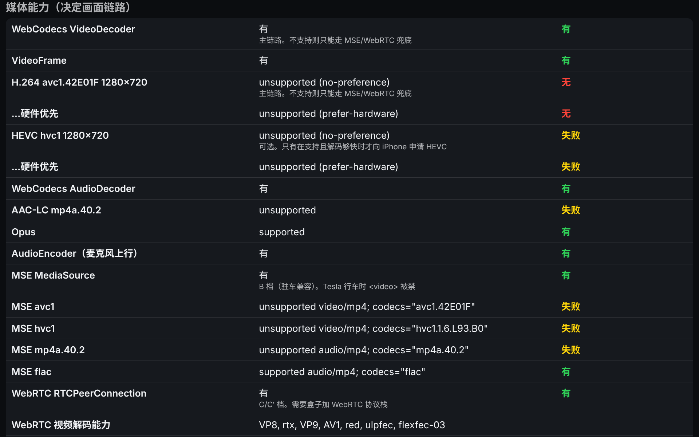

# 阶段 0：车机浏览器能力探测页

`index.html` 是一个单文件页面（内联 CSS/JS，不引用任何外部资源），在车机浏览器里打开后把决定 AutoPlay 画面链路和音频模式的能力逐项列出来，字号 ≥26px，便于在驾驶位读取。对应《F50 车机浏览器 CarPlay 技术路径》第六节"阶段 0"的验收标准：**一张能力表，据此定下画面档位和音频模式**。

页面不需要盒子、不需要 iPhone，http 和 https 下都能打开；所有探测都包在 `try/catch` 里，缺什么就显示"不可用"，不会整页白屏。

## 怎么打开

两种方式，推荐都做一遍，因为 http 和 https 下结果不同（WebCodecs 只在安全上下文里存在）：

1. **从盒子上提供（https）。** 把 `index.html` 放到接收端的静态目录（`receiver/web/dist/`，静态文件不需要令牌），用车机浏览器打开 `https://<你的域名>:18443/probe/index.html`。这测的是真实的部署环境：自己的域名（DuckDNS 或 DNSPod）、Let's Encrypt 证书、100.96 网段。
2. **从任意 https 主机提供。** 任何能被车机访问的 https 静态站（自己的服务器、对象存储、GitHub Pages 都行）。这能在还没装好盒子时先摸清浏览器。注意：从公网主机打开时，"网络可达性"一节里对 100.96 / 192.168 地址的请求会被当作私网请求（PNA）或混合内容拦截，结果只代表那种场景。
3. **纯 http 的对照（可选）。** 例如 `http://100.96.0.1/probe/index.html`。用来回答两个问题：Tesla 是否允许打开 http 的 CGNAT 地址；HTTP 页面下主线程有没有 `MediaStreamTrackProcessor`（C′ 档成立的前提）。

打开后先**轻点屏幕任意位置**（页面底部有蓝条提示），这一下记录 AudioContext 解锁前后的状态。然后依次点"请求全屏""请求屏幕常亮""请求麦克风"，在触控区按两根手指，最后做画布动画测试和可达性测试。

结果用"复制结果"复制到剪贴板（Tesla 浏览器的剪贴板可能不可用，这时长按文本框手动复制，或直接拍照），也可以"POST 到盒子"（默认 `https://100.96.0.1:18443/probe`；当前接收端还没有这个接口，失败会被静默容忍，这个按钮是给以后的盒子端留的）。

## 每一行是什么意思

### 环境

| 行 | 含义 | 用途 |
|---|---|---|
| userAgent / Chrome 大版本 / userAgentData | 浏览器身份 | 兼容显示模式按 `/Chrome\/(\d+)/` 自动判断；Tesla 跨 113 到 148，两头都不能写死（《特斯拉专属精简补充》§六）。<94 说明没有 WebCodecs |
| screen 尺寸 / innerWidth × innerHeight / outerWidth | 屏幕与视口 | 决定向 iPhone 申请的流尺寸。Tesla 只有两种横屏形状：带边框约 773×601 CSS px、无边框约 1256×706 CSS px |
| devicePixelRatio / visualViewport.scale | 缩放 | Tesla 2026.26 之后默认缩放提高且不可调，CSS 像素 ≠ 物理像素；字号和触控目标要按设备像素核对（《界面审查》§四） |
| isSecureContext / 页面协议 | 安全上下文 | **决定行**：false 时 WebCodecs、getUserMedia、Wake Lock 全部不可用，只能走 B/C 档 |
| prefers-color-scheme（实时） | 车机的深浅色 | 这是《特斯拉专属精简补充》§四列的缺口之一：一趟车就能补上 |
| prefers-reduced-motion、language、hardwareConcurrency、orientation、visibilityState、pointer/hover | 杂项 | 排版与调试参考 |

### 媒体能力（决定画面链路）

| 行 | 含义 | 决定什么 |
|---|---|---|
| **WebCodecs VideoDecoder** + **H.264 avc1.42E01F 1280×720** | `isConfigSupported` 的结果，分"无偏好"和"硬件优先"两次 | **A 档（主链路）成立的条件。** 两次都 unsupported → 这台车机走不了 WebCodecs，只能考虑 B/C 档 |
| HEVC hvc1 1280×720 | 同上 | 可选。只有在支持、并且实测解码够快时才向 iPhone 申请 HEVC；浏览器没有 HEVC 软解兜底 |
| WebCodecs AudioDecoder：AAC-LC / Opus | 浏览器音频模式下能否直接解 iPhone 发来的 AAC | 已定（ADR-14，1.1.0）：页面永远不播音乐，默认声音全部走车载蓝牙；此行只对 `carplay` 声音模式下的导航播报有意义 |
| AudioEncoder | 麦克风上行需要 Opus 编码 | 特斯拉模式下不提供麦克风，此行只对浏览器音频模式有意义 |
| MSE MediaSource + avc1 / hvc1 / mp4a / flac | `isTypeSupported` | **B 档（驻车兼容）**。Tesla 行车时 `<video>` 被禁，所以 B 档只能驻车用。页面里已没有 MSE 代码（1.1.0），此行仅作记录 |
| WebRTC RTCPeerConnection + 视频解码能力 | 存在性 + `RTCRtpReceiver.getCapabilities('video')` 的编解码器列表 | **C 档**。列表里有 H264 才有意义；H265 需要 Chrome 136+ |
| MediaStreamTrackProcessor（主线程） | 存在性 | **C′ 档**（WheelPlay 的"直接 Canvas"）：WebRTC 收流后不经 `<video>` 直接画到 canvas。HTTP 页面下主线程可用才成立；成立的话可以省掉整套证书方案（推断，待上车验证） |
| getUserMedia 存在 | 只看存在，不申请 | 实际申请在下一节 |
| Media Session API | 存在性 | 方向盘按键是否交给网页，看"按键事件"行；页面已不用 Media Session（裁剪），仅作记录 |
| fullscreenEnabled / Wake Lock / WebSocket / Worker+OffscreenCanvas | 存在性 | WebSocket 是硬要求；Worker+OffscreenCanvas 是页面减负（解码放 Worker）的前提 |

### 需要轻点后才能测的

| 行 | 含义 |
|---|---|
| AudioContext 状态（加载时 / 轻点后） | 加载时 `suspended`、轻点后 `running` = 典型的自动播放策略：第一次触摸之前车里没有声音。这就是"轻点开启声音"提示必须保留且做大的依据（《特斯拉专属精简补充》§一第 1 条、《界面审查》V7） |
| `<audio>` 播放 | 页面内建一段 1 秒静音 WAV，轻点后播放。成功才会把页面注册为媒体会话 |
| Media Session 按键事件 | 装好处理器后，按方向盘的上一曲/下一曲/播放暂停，看这里有没有记录。这是《技术路径》§八里"Tesla 方向盘按键是否交给网页"的直接答案 |
| requestFullscreen 结果 | granted 说明标准全屏可用（Tesla 过去不认，DashPlay 靠跳转视频网站拿无边框，所以这一行在 Tesla 上大概率是 `TypeError`/拒绝） |
| Wake Lock 请求结果 | 屏幕常亮 |
| getUserMedia 请求结果 | 会弹权限框。Tesla 只有 Ryzen 车型支持；granted 时会显示设备名、采样率和 AEC 是否开启 |

### 触控

| 行 | 含义 |
|---|---|
| PointerEvent / maxTouchPoints | 事件模型 |
| 当前触点数 / 最大同时触点数 | 在触控区按两根手指，看最大值是否 ≥2（CarPlay 地图缩放需要多点触控；DashPlay 的触摸补丁按单点设计） |
| 收到的事件类型 | 有些车机只发 mouse 事件、不发 touch/pointer，会影响触摸延迟和滑动判定 |

### 画布动画测试

停车时点"开始 10 秒"（或 60 秒），然后挂 D 挡驶出。页面记录：

- **rAF 帧数 / 平均 fps**：行车中计数器还在走、fps 没掉，说明 canvas 路线在行车时可用（Tesla 对 `<video>` 的行车限制不波及 canvas，这是 A 档的前提之一，目前只有多个项目的报告、没有官方说明）。
- **setInterval 计数**：rAF 停了而 setInterval 还在走，说明页面被标为隐藏/后台节流，而不是整个标签页被冻结。
- **最大帧间隔、visibilitychange 次数、页面被隐藏的总时长**：倒车影像、弹窗覆盖都会在这里留下痕迹（对应 DashPlay 的"倒车冻结标签页、盒子 10 分钟保持链路"路径）。

### 网络可达性

每行一个地址，`fetch(..., {mode:'no-cors'})`，4 秒超时。能分辨三种结果：

- **有应答（opaque）**：地址可达，浏览器没有拦截。
- **TypeError: Failed to fetch**：被浏览器拒绝、不可达，或者 https 页面请求 http 地址被当作混合内容。
- **超时**：有路由但没人应答。

默认测 `100.96.0.1`（CGNAT 网段，DashPlay 的 Tesla 模式）和 `192.168.1.1`（私网）各一个 http、一个 https，以及 Apple 的联网检测页。用它回答《技术路径》§八的问题："车机浏览器能否访问 100.64 和私网地址"。注意从 https 页面发起 http 请求的结果不能用来下"私网被拦截"的结论，要用 http 页面再测一遍。

## 哪些行决定画面路径

按《技术路径》§3.4 的分档：

1. `isSecureContext = true` 且 `H.264 avc1.42E01F` 任一项 supported，且画布动画在行车中不停 → **A 档**（WebCodecs → canvas，默认）。
2. A 不成立，但 `MSE avc1` supported → **B 档**（MSE + `<video>`，只能驻车用）。
3. `RTCPeerConnection` 存在且 WebRTC 解码列表含 H264 → **C 档**可做；再加上 HTTP 页面下 `MediaStreamTrackProcessor` 存在 → **C′ 档**候选，值得专门上车验证"行车时画面还刷不刷新"。
4. HEVC 行只影响是否向 iPhone 申请 H.265，不影响档位。

音频模式：`AudioContext` 轻点后才 `running` + `AAC-LC unsupported` 的组合，是"优先走车载蓝牙"的又一个理由（《技术路径》§3.5 模式一）。

## 已知限制

- 无头或桌面 Chromium 的开源构建不带 H.264/AAC 解码器，本仓库 `docs/images/probe.png` 里的 unsupported 是这个原因，不代表页面有问题。
- `isConfigSupported` 回答的是"配置能不能开"，不是"解码够不够快"。解码速度要靠接收端会话里的统计（DashPlay 的 `decode-backlog` 补丁和 HUD）。
- Media Session 的按键事件只有在 `<audio>` 真的在播放时才会被路由到页面；如果"`<audio>` 播放"一行失败，"按键事件"一行就测不出来。
- 页面不做任何上传或埋点；"POST 到盒子"只在你点击时发送，目标地址可改。

> 2026-11-03 补记：A 档（WebCodecs → canvas）已于 2026-11-02 在车上看到画面（停车）；探测页本身还没在车上跑过，`docs/TESLA.md` §7 等着它的结果。
